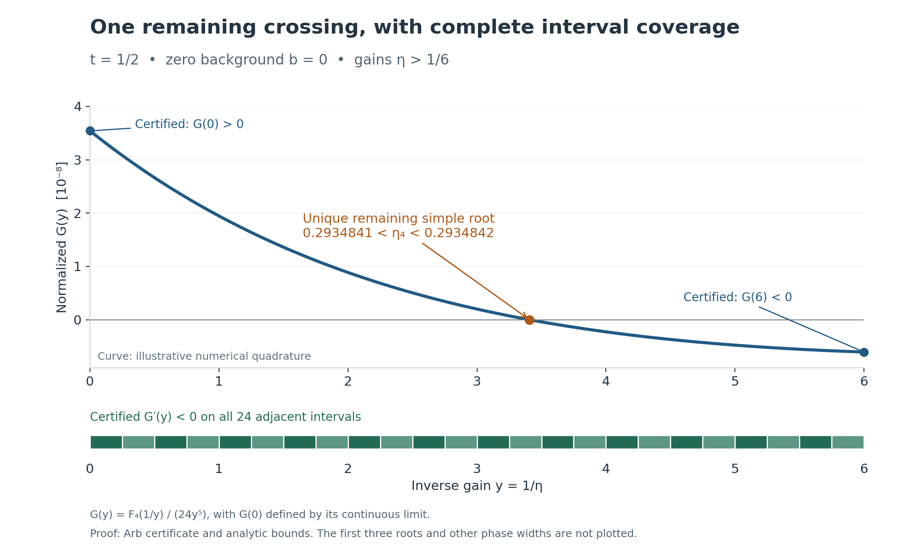

# Homometric photon counts

Proofs and reproducible certificates for distinguishing two fixed 63-site homometric structures under independent Gaussian phase motion and conditional Poisson photon counting.

This is conditional mathematical research. The repository contains no measured detector data, established novelty claim, or practical acquisition recommendation. Its exact assumptions and remaining gaps are part of the results.

## Start with a check

With Python 3.11 or later, run from this directory:

```sh
python tools/project.py verify
python tools/project.py test --output build/first-check
```

These commands use the standard library, run offline, and preserve the evidence. `verify` checks bytes and input bindings. `test` reruns exact endpoint constants, a necessary sample bound, an independently coded sample exclusion, and the exact phasor reconstruction. Neither command proves every analytic step.

For the longer Arb reconstruction, follow the [reproduction guide](docs/reproduction.md). The [reviewer guide](docs/reviewer-guide.md) provides a short route through the proofs.

## Results and their scope

Write $t=\exp(-s/2)$, where $s>0$ is the phase variance. For fixed unit phasors $z_{G,j}$, independent standard normal variables $Z_j$, gain $\eta>0$, and common background $b\geq0$,

$$I_G=\left|\sum_{j=1}^{63}z_{G,j}e^{i\sqrt{s}Z_j}\right|^2,\qquad N\mid I_G\sim\mathrm{Poisson}(b+\eta I_G).$$

| Result | Precise scope |
| --- | --- |
| Full count laws differ | The first three intensity moments match; the fourth differs positively for every $0<t<1$. The fourth factorial-count moment gap is $\eta^4D_4(t)$ under the stated detector model. |
| Exactly four positive blind gains | At $t=1/2$ and $b=0$, the event $N=4$ has equal probability under the two structures at exactly four simple positive gains. The final root lies in $(0.2934841,0.2934842)$. The proof includes every arbitrarily large gain. |
| Four roots persist locally | Exactly four simple roots persist for sufficiently small changes in phase variance and nonnegative background. This is an existence theorem; a full usable neighborhood radius has not been computed. |
| Necessary and sufficient counts | At $s=2\log2,\eta=1/20,b=0$, with iid observations of the fixed bins $0,\ldots,11,\geq12$, any test with each error below 5% needs at least **28,091,647,285,174** observations. A certified score succeeds with **102,399,876,723,169**. The ratio is below 3.646; the optimum is unknown. |
| Focused formal proofs | Lean sources prove concrete phase geometry, Gaussian phase expectations, an all-order intensity-moment formula and site-by-site recurrence, integrability, and the constructed Gaussian/Poisson count law. The polynomial representation, degree bound and 33-node implication are also proved. Concrete exact evaluation for the specific 63-site moment matches and fourth-gap identity remains open. |

A blind gain concerns the single event $N=4$, not equality of the full count laws. All sample counts above are for the specified binned iid experiment; they do not describe arbitrary detectors, temporal dependence, unknown calibration, or an optimized design.



The curve is illustrative numerical quadrature. The endpoint signs and interval coverage come from the separately linked certificate; the first three roots are outside this plot's gain range.

The [claim ledger](docs/claims.md) links each result to its actual proof, certificate, replay, and remaining assumptions. The [model guide](docs/model.md) separates this homogeneous phase model from the archived historical extensions.

The [validation record](docs/validation/README.md) distinguishes local formal checks from executed GitHub CI. The [verification-tool status](docs/verification-tools.md) separates completed checks from possible additional checks.

The [Gaussian formalization](formal/GAUSSIAN.md) derives the general expectation formula and proves a site-by-site moment recurrence for any finite complex geometry. Its concrete exact-arithmetic evaluation remains unfinished; the recurrence does not establish the same separating result for arbitrary structures.

## Research provenance

Substantial parts of the arguments, code, checks, and documentation were developed with AI assistance under human direction. The maintainer did not independently derive or manually verify every step. Internal alternative implementations provide useful evidence but are not external human review. Read the [methods and limitations disclosure](docs/research-disclosure.md).

AI tools are not listed as authors or Git contributors. Git identity and scientific-methods disclosure serve different purposes.

## Reproduce and challenge

The research capsule preserves explicit assumptions, exact rational inputs, analytic arguments, interval certificates, source code, and formal statements. Its [public provenance record](docs/provenance.md) describes the removal of machine-specific paths and the resulting hash updates. Mathematical inputs are not silently replaced.

Report a proof gap with its statement, model, evidence path, and a concrete counterexample or failed implication. Report a reproduction failure with the command, Python version, and output. See [contribution guidance](.github/CONTRIBUTING.md).

Open work includes the remaining formal model links, a quantitative stability neighborhood, root counts over the full parameter domain, optimal testing/design, primary-literature comparison, and physical validation. See the [research roadmap](docs/roadmap.md).

Maintained under the pseudonym **The Quantum Falcon**. Project-owned code and documentation are [MIT licensed](LICENSE.txt); [third-party terms remain intact](LICENSE_STATUS.md). The [public repository](https://github.com/thequantumfalcon/homometric-photon-counts) is available for inspection. It has no tagged scientific release or external peer-review endorsement. See the [repository status](docs/repository-readiness.md) for verified settings and checks.
