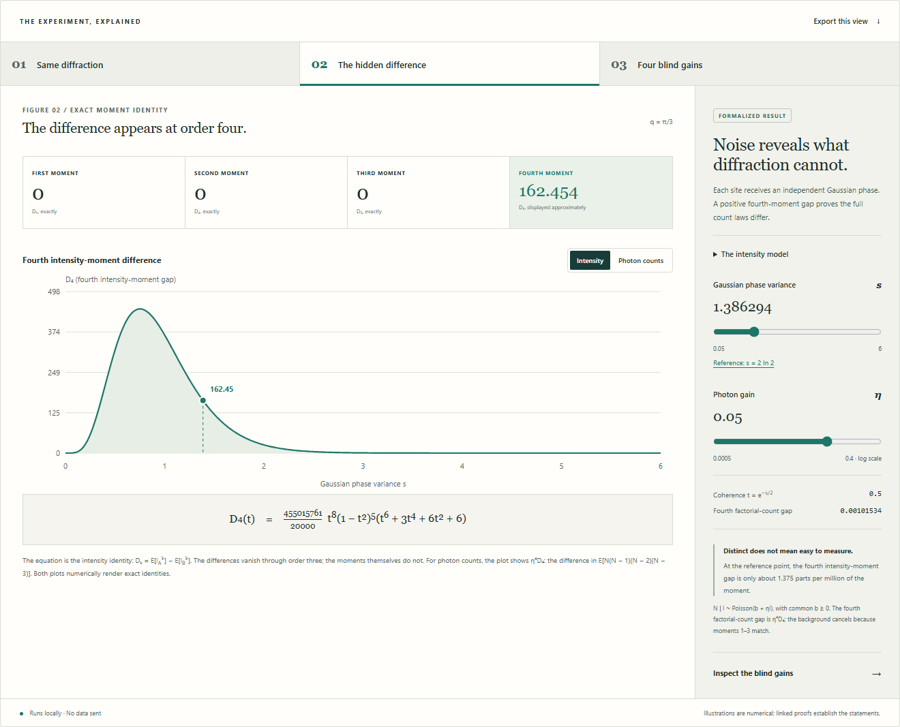

# Homometric photon counts

[](https://github.com/thequantumfalcon/homometric-photon-counts/actions/workflows/ci.yml?query=branch%3Amain)

Proofs and reproducible certificates for distinguishing two fixed 63-site homometric structures under independent Gaussian phase motion and conditional Poisson photon counting.

This is conditional mathematical research. The repository includes processed detector data from an external published study. It contains no measurements of the proposed apparatus, does not establish novelty, and makes no practical acquisition recommendation. Its exact assumptions and remaining gaps are part of the results.

## Construction and result

Let $\theta=\arcsin(1/(5\sqrt3))$, $\phi=-\arcsin(1/(8\sqrt3))$, and let $\epsilon_0=\epsilon_1=0$, $\epsilon_j=(-1)^j\phi$ for $2\le j<10$. Define the 21-site motif

$$C=\{30\}\cup\{3j+1+3(-1)^j\theta/\pi:0\le j<10\}\cup\{3j+3\epsilon_j/\pi:0\le j<10\}.$$

The two sets are $A=C+\{0,31,63\}$ and $B=C+\{0,32,63\}$, where set addition means all pairwise sums. Each has 63 distinct real sites; their directed pair differences agree with multiplicities, although no translation or reflection maps one set onto the other. Use spatial angular frequency $q=\pi/3$ and phasors $z_{G,j}=e^{iqx_{G,j}}$ for positions $x_{G,j}$ in $G=A,B$.

With independent Gaussian site phases of variance $s>0$, write $t=e^{-s/2}$ and $D_k(t)=\mathbb E[I_A^k]-\mathbb E[I_B^k]$ for the intensity moments defined below. Then $D_1=D_2=D_3=0$ and

$$D_4(t)=\frac{455015761}{20000}t^8(1-t^2)^5(t^6+3t^4+6t^2+6)>0\qquad(0<t<1).$$

The clean amplitude vanishes and the first three moments depend only on shared quantities; order four introduces an unequal phase-sensitive invariant. See the [coordinate construction](formal/COORDINATES.md), [moment derivation](evidence/homometric-photon-counts/science_completion/homogeneous_control/homogeneous_control_proof.txt), and [formal certificates](formal/CERTIFICATES.md).

Start with the [23 October report update](docs/report/update-2026-10-23.md) by Thomas Albrecht, which covers the later four-root certificates, sample bounds and completed concrete formal proof. The [historical 18-page report and LaTeX sources](docs/report/README.md) retain their original bytes and provide the foundational derivations.

## Explore the result

A **blind gain** is a positive detector gain at which the two structures have the same probability of recording exactly four photons ($N=4$). The full photon-count distributions still differ.

The [offline interactive demo](demo/index.html) follows the geometry, identical clean diffraction, fourth-moment separation and four certified blind gains. Download the repository and open `demo/index.html`, or use the [local preview instructions](demo/README.md). Its 2D plots and optional 3D phase view explain the source-bound formulas and exact certificate endpoints; the demo is not a proof or a physical apparatus. See the [demo validation guide](docs/demo-testing.md).



## Reproduce the basic checks

With Python 3.11 or later, run from this directory:

```sh
python tools/project.py verify
python tools/project.py test --output build/first-check
```

These commands use the standard library, run offline, and preserve the evidence. `verify` checks bytes and input bindings. `test` reruns exact endpoint constants, a necessary sample bound, an independently coded sample exclusion, and the exact phasor reconstruction. Neither command proves every analytic step.

The [reproduction guide](docs/reproduction.md) covers longer Arb replays and pinned Windows/Linux dependencies. The [reviewer guide](docs/reviewer-guide.md) gives a short route through the proofs; the [validation record](docs/validation/README.md) records executed checks.

## Results and their scope

Write $t=\exp(-s/2)$, where $s>0$ is the phase variance. For fixed unit phasors $z_{G,j}$, independent standard normal variables $Z_j$, gain $\eta>0$, and common background $b\geq0$,

$$I_G=\left|\sum_{j=1}^{63}z_{G,j}e^{i\sqrt{s}Z_j}\right|^2,\qquad N\mid I_G\sim\mathrm{Poisson}(b+\eta I_G).$$

| Result | Precise scope |
| --- | --- |
| Exact noncongruent homometric sets | Lean proves that the saved symbolic coordinates define two sets of 63 distinct real positions, with the same 3,969 directed pair differences including multiplicities, and excludes every translation and reflection between them. See the [geometric theorem](formal/HOMOMETRY.md). |
| Full count laws differ | The first three intensity moments match; the fourth differs positively for every $0<t<1$. The fourth factorial-count moment gap is $\eta^4D_4(t)$ under the stated detector model. |
| Exactly four positive blind gains | At $t=1/2$ and $b=0$, the event $N=4$ has equal probability under the two structures at exactly four simple positive gains. The final root lies in $(0.2934841,0.2934842)$. The proof covers all positive gains, however large. |
| Four roots persist on an explicit rectangle | Exactly four simple roots persist for $\lvert t-1/2\rvert\le10^{-23}$ and $0\le b\le10^{-20}$. The [analytic proof and exact rational budget](docs/root-stability.md) cover every positive gain. These conservative radii do not establish practical experimental tolerance; this result is not Lean-formalized. |
| Necessary and sufficient counts | At $s=2\log2,\eta=1/20,b=0$, with iid observations of the fixed bins $0,\ldots,11,\geq12$, any test with each error below 5% needs at least **28,091,647,285,174** observations. A certified score succeeds with **102,399,876,723,169**. The ratio is below 3.646; the optimum is unknown. |
| Formal count-law distinction | Lean proves the concrete first-three-moment matches, fourth-gap identity, and inequality of the two constructed count laws for every positive variance and gain and every common nonnegative background. The proof connects the explicit 63-site phase lists, Gaussian integrals and Poisson mixtures without assuming the concrete moment values. See the [certificate scope](formal/CERTIFICATES.md) and [executed checks](docs/validation/README.md). |

The sample counts require tens of trillions of independent observations for this fixed reference experiment; they do not establish a practical acquisition plan. The lower bound applies to the specified gain, variance, background and 13-bin iid observation, not to all measurements at this frequency. Arbitrary detectors, temporal dependence, unknown calibration and optimized designs need separate analysis.

The [claim ledger](docs/claims.md) links each result to its proof and assumptions. The [model guide](docs/model.md) and [formal validation record](docs/validation/README.md) explain the Gaussian/Poisson construction and Lean coverage. Root-count and testing arguments are not fully formalized in Lean. See also the [verification-tool status](docs/verification-tools.md) and [fixed-test model-error bound](docs/model-tolerance.md).

## Bounded optical feasibility study

The [optical-study guide](docs/optical-studies.md) covers the separate feasibility, calibration, external detector-data and transfer studies. They use a **second-order signal at a different frequency**, with their own assumptions and sample bounds. They do not demonstrate the original fourth-order-only effect or physically validate the proposed apparatus.

## Research provenance

Substantial parts of the arguments, code and checks were developed with AI assistance under human direction. The maintainer did not independently derive or manually verify every step. Read the [methods disclosure](docs/research-disclosure.md) and [evidence provenance](docs/provenance.md). Internal checks are not external human peer review. AI tools are not listed as authors or Git contributors.

## Reproduce and challenge

Report a proof gap with its statement, model, evidence path, and a concrete counterexample or failed implication. Report a reproduction failure with the command, Python version, and output. See [contribution guidance](.github/CONTRIBUTING.md).

See the [research roadmap](docs/roadmap.md) for open mathematical and experimental work and the [priority comparison](docs/priority.md) for established antecedents and unresolved novelty questions.

Maintained by **Thomas Albrecht**. Project-owned code and documentation are [MIT licensed](LICENSE.txt); [third-party terms remain intact](LICENSE_STATUS.md). The [public repository](https://github.com/thequantumfalcon/homometric-photon-counts) is available for inspection. It has no tagged scientific release or external peer-review endorsement. See the [repository status](docs/repository-readiness.md) for verified settings and checks.
