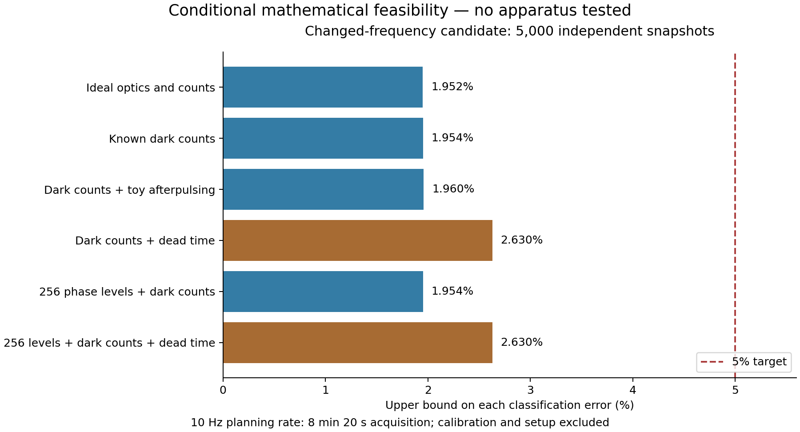

# Optical feasibility extension

This bounded simulation and arithmetic study asks whether a programmable optical
emulator could distinguish the same two coordinate sets within an acquisition
budget. It contains **no measured detector data or hardware validation**. The
original proofs and the 327-file historical evidence inventory are unchanged.

Later [optical transfer and detector supplements](../optical-validation/README.md)
add a continuum optical model, robustness simulations, external processed SPAD
data and finite arithmetic checks. Those additions have separate assumptions;
they do not retroactively broaden the certificates on this page.

| Experiment | Result under its stated model |
| --- | --- |
| Original frequency, reference variance/gain and 13-bin counts | At 288,000 iid snapshots, equal-prior error is at least **49.9934757992162%**. This is an eight-hour budget only at the assumed 10 independent snapshots/second. |
| Changed frequency, unbinned counts, known parameters | A fixed second-factorial score at 5,000 iid snapshots has each error below **2.63%** in six separately modeled scenarios, with scenario-specific thresholds. |
| Changed frequency, unknown but fixed calibration within a continuous box | One fixed score and threshold give each error below **4.53%** at 5,000 iid snapshots for simultaneous gain and phase-variance uncertainty of ±2% and background 0.10–0.15 counts/gate. |
| Wider continuous calibration box | The same score and threshold give each error below **4.90%** at 11,000 iid snapshots for gain and phase-variance uncertainty of ±4% and background 0.075–0.175 counts/gate. |

These are different statistical experiments. The new frequency exposes a
**second-intensity-moment difference**; it does not demonstrate the original
fourth-order-only signal or contradict that experiment's sample lower bound.
No optimal design, general imaging breakthrough or novelty is claimed.

## Model and fixed decision rule

Use the retained exact symbolic 63-site coordinates, equal field amplitudes,
spatial frequency `q = 201*pi/200`, and independent Gaussian site phases. The
nominal phase variance is `s = 1/20 rad^2`, gain is 1, and background is 1/8
counts per 5 ms gate. The calibration-box result uses ideal uniform 256-level
rounding of the commanded optical phase and an initially-live nonparalyzable
detector with dead time anywhere from 0 to 22 ns. Parameters are fixed across
iid snapshots; a variance bound alone does not establish the Gaussian law.

For the observed unbinned count `N`, keep the score and threshold fixed:

```text
Y(N) = N*(N-1)/3969 - (17/10)*N/63
Choose A if mean(Y) < -0.6401102; otherwise choose B.
```

The ±2% box is gain `[0.98,1.02]`, pre-quantization phase variance
`[0.049,0.051] rad^2`, and background `[0.10,0.15]` counts/gate. Error upper
bounds are approximately 2.2218% for A and 4.5243% for B. The wider box is gain
`[0.96,1.04]`, variance `[0.048,0.052]`, background `[0.075,0.175]`; at 11,000
snapshots the bounds are approximately 1.8293% and 4.89992%. The uncertainty is
simultaneous and continuous, not just a grid of parameter points. The tested
±8% box was not certified; this does not establish impossibility.

At an assumed 10 independent snapshots/second, acquisition alone takes 8 min
20 s or 18 min 20 s respectively. Setup, calibration and settling validation
are additional work; these durations are not measured instrument performance.

## Evidence and limitations

The proposed emulator has 63 active regions of an 8×8 phase modulator, a
Fourier lens, selected single-mode collection and a photon counter. A discrete
unitary Fourier model checks the ideal projection. It does not derive a full
continuous optical transfer function. The documented component specifications
are illustrative inputs, not an endorsed hardware design.

An independent Arb recurrence encloses intensity moments; exact rational
Cantelli bounds convert score means and variances into error guarantees. The
calibration calculation translates ball-coefficient polynomials before
interval substitution to control cancellation. These are analytic/computational
certificates, **not new Lean theorems**. See the complete derivations:

- [Changed-frequency method](simulation-prototype/design-search/METHOD.txt),
  [certificate](simulation-prototype/design-search/interval-final/certificate.json),
  [search](simulation-prototype/design-search/scan-01/search.json).
- [Continuous-box method](simulation-prototype/calibration-study/METHOD.txt),
  [certificate](simulation-prototype/calibration-study/run-checked/calibration.json).
- [Original-budget study](simulation-prototype/feasibility-study/README.txt),
  [results](simulation-prototype/feasibility-study/run-checked/results.json).
- [Held-out simulation](simulation-prototype/design-search/heldout-final/simulation.json):
  zero errors in 200 trials per structure in each of four simplified non-dead-time
  scenarios, with 5,000 snapshots/trial. Shared phase draws prevent pooling the
  scenarios as independent trials. Zero observed errors do not prove zero true error.

Afterpulsing and dead time are studied separately in the known-parameter
certificate; they are not jointly modeled. The continuous-box certificate
includes dead time and excludes afterpulsing. Actual optical phase levels,
unequal field amplitudes, transfer errors, temporal dependence and instrument
memory remain unvalidated. No Finesse execution or unknown-material imaging
experiment occurred. Physical usefulness and novelty remain open.



## Reproduce without replacing evidence

From the repository root, the following uses only the Python standard library:

```sh
python tools/optical_study.py verify
python -m unittest discover -s tests
```

It checks all 36 archived files, their original nested manifests, three retained
inputs, the reference budget, 24 exact risk records and the rounded 5,000/11,000
snapshot guarantees. Arithmetic checking assumes the retained moment enclosures;
it does not reconstruct them.

To reconstruct both Arb certificates and run 18 original prototype/calibration
tests, use the existing pinned Windows python-flint 0.9.0 environment described
in the [reproduction guide](../../docs/reproduction.md):

```sh
python tools/optical_study.py replay --output build/optical-replay
```

`PHOTON_FLINT_RUNTIME` can select an existing isolated installation. The command
installs nothing, requires a fresh output directory and copies only the sealed
study files and three inputs into `build/optical-replay/workspace`. Both new
JSON results must equal their retained counterparts in every field except
runtime metadata. CI executes this replay on Windows; the standard-library
integrity and risk checks run on Windows and Linux.

For the 20 additional exploratory tests, NumPy 2.2.6, SciPy 1.16.3 and
Matplotlib 3.10.8 are the recorded dependency versions. They are optional and
are not part of the hash-locked core certificate environment. Use a separate
environment with [these version pins](requirements-exploration.txt), then:

```sh
python tools/optical_study.py replay --exploratory-tests --output build/optical-full
```

To rerun searches, Monte Carlo or plotting manually, first create a fresh
staging folder with `python tools/optical_study.py stage --output build/optical-work`.
Use its `workspace` as the working directory for the original archived README
commands. Set `PYTHONPATH` to an existing flint installation if needed; commands
run manually do not interpret `PHOTON_FLINT_RUNTIME`. Choose new output paths.
The archived 256-bit arithmetic does not require NumPy, SciPy or Matplotlib.

## Provenance

The [publication manifest](manifest.json) identifies every selected original
file. All are byte-for-byte copies, including source, figures, results and
historical receipts. No private paths, toolchain binaries, third-party articles
or development outputs are included. Original `public_repository_changed: false`
fields accurately describe the local executions before this publication.
Original README commands describe the staged workspace layout; this README and
the wrapper are the supported public entry points. The manifest anchor checks
identity, not independent scientific truth or authenticity if both are replaced.

The existing [AI-assistance disclosure](../../docs/research-disclosure.md) and
[MIT license](../../LICENSE.txt) apply. AI tools receive no Git contributor or
authorship credit. The next scientific step is independent review of the
optical transfer, calibration and detector assumptions before a hardware trial.
